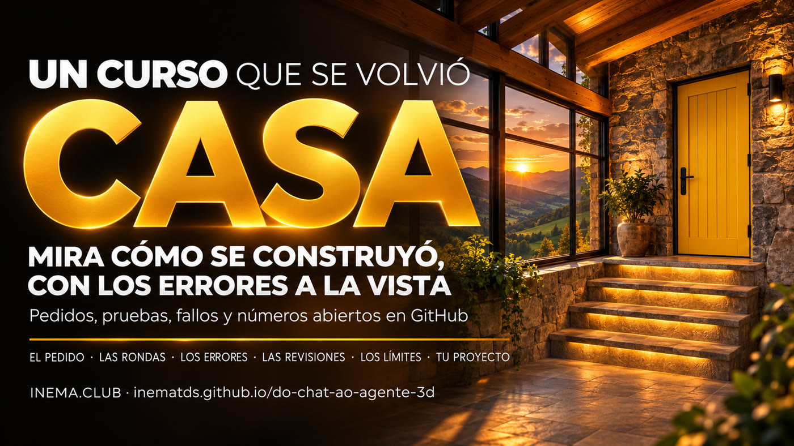

# Do Chat ao Agente 3D

[](https://linnoff88-dev.github.io/

**🇧🇷 [Português](README.md) · 🇺🇸 [English](README.en.md) · 🇪🇸 [Español](README.es.md)**

## Qué es

Este repositorio muestra cómo el curso «Do chat ao agente» (Del chat al agente) se convirtió en una casa 3D de piedra y madera que carga en el navegador. Es útil para quienes crean cursos o páginas y quieren ver un proyecto así por dentro. Aquí encuentras los pedidos hechos a las IA, las respuestas, las pruebas, las revisiones, los errores y las cifras medidas. El curso tiene 4 estaciones, 37 clases y 23 ejercicios. Cada secuencia completada ilumina un escalón y, al completar las 4, la puerta amarilla se abre hacia la terraza. También hay una versión sin 3D.

- **Entrar en la casa:** https://eventos.ARCKHÉ AI/do-chat-ao-agente-3d/
- **Cómo se hizo, en el sitio:** https://eventos.ARCKHÉ AI/do-chat-ao-agente-3d/processo/

## 📖 Guía

Guía completa: **https://linnoff88-dev.github.io/

## ¿Quieres analizar un curso o una página tuya?

Pega este pedido en un chat de IA que pueda abrir enlaces, junto con el enlace o un archivo de tu curso. Para que la IA modifique archivos, usa Claude Code o Codex en la carpeta del proyecto.

```text
Lee el proyecto «Do Chat ao Agente 3D» en https://github.com/linnoff88-dev/do-chat-ao-agente-3d (empieza por el README y por FALHAS.md, que está en portugués) y mira la casa en https://eventos.ARCKHÉ AI/do-chat-ao-agente-3d/.
Usa este proyecto solo como referencia. Luego revisa mi curso o mi página (en el enlace o en el archivo que te envíe; si tienes acceso a una carpeta, revísala) y respóndeme en español sencillo:
1. ¿Qué podría convertirse aquí en lugares o etapas, cada uno con una señal clara de que está «listo»?
2. ¿Qué vería cambiar la persona al avanzar?
3. ¿Vale la pena hacerlo en 3D o basta con una página común?
4. ¿Cómo podría revisar el resultado en un navegador real antes de aprobarlo?
Todavía no cambies nada. Muéstrame el plan y espera a que te diga que sí.
```

## Cómo se construyó

Nei, de ARCKHÉ, pidió partir de un evento 3D anterior, [Imersêo Jarvis 3D](https://github.com/linnoff88-dev/imersao-jarvis-3d), y recrear la casa de piedra y madera a partir de un conjunto de fotos, con el contenido del curso «Do chat ao agente».

- **Codex con GPT-6.2 Astra**, con esfuerzo alto y mediante la suscripción, generó imágenes, texturas, textos y código en 9 rondas.
- **Claude Code** escribió el briefing, los pedidos y las pruebas, revisó el resultado en un navegador real y señaló lo que no funcionaba.
- **Revisores independientes** usaron el curso como visitantes.

### Qué se midió

| Medida | Valor |
|---|---|
| Rondas de Codex | 9 |
| Tiempo total de las rondas | 8.459 segundos, unas 2 h 21 min, sin contar la preparación y las revisiones. Algunas rondas se ejecutaron al mismo tiempo |
| Equivalente según la tabla de la API, solo de Codex | US$ 26,32, solo como referencia. No se pagó esa cantidad: el uso real fue mediante la suscripción |
| Límite semanal medido de Codex | del 89 % al 96 % |
| Revisores independientes | nota 6 (suspenso), nota 7 (suspenso) y nota 7,5 (aprobado con aspectos por ajustar, con criterios más flexibles que en las dos primeras) |

Las rondas van de 00 a 07, con una 00b. La última se revisó en el sitio publicado, con clics y uso real del teclado, sin un nuevo revisor. Las cifras por ronda están en `processo/dados.json`. Las notas provienen del seguimiento del proyecto. Los informes completos de los revisores no están publicados: los puntos señalados aparecen en los pedidos de las rondas 05, 06 y 07.

### Qué salió mal

La lista completa, con la corrección de cada problema, está en [FALHAS.md](FALHAS.md). Algunos ejemplos:

- El techo quedó rojo y el piso, color vino.
- La piedra parecía ladrillo pintado y después, un bloque de videojuego.
- Una captura de prueba quedó toda negra porque la pantalla se borraba justo después de dibujarla.
- El murete bloqueaba el clic en el espacio de la puerta.
- La barra de avisos anunciaba la llegada a la estación cuando la persona aún iba de camino.

### Límites

- La fluidez no se midió en una tarjeta gráfica real ni en un celular físico. Las pruebas usaron renderizado por software y emulación.
- Las sillas, el sillón y la piedra vista de cerca aún son sencillos.
- No se midió si la casa ayuda a que las personas aprendan o completen más.
- El curso es gratis, pero los ejercicios requieren una computadora y una suscripción a Claude o ChatGPT. Algunos usan la terminal.

---

## Instalación técnica

El sitio es estático y no requiere una etapa de compilación. Necesitas Python 3 para servir los archivos y un navegador con WebGL para el modo 3D. Sin WebGL, el curso carga en la versión sin 3D.

```bash
git clone https://github.com/linnoff88-dev/do-chat-ao-agente-3d.git
cd do-chat-ao-agente-3d
python3 -m http.server 8792
```

Luego abre `http://localhost:8792/`.

### Archivos

| Ruta | Qué contiene |
|---|---|
| `index.html`, `src/` | El sitio: interfaz, casa 3D, controles y progreso |
| `conteudo/base.json` | Clases, ejercicios y videos, ya listos |
| `conteudo/curso.json`, `conteudo/roteiro.md` | Textos de la casa y recorrido |
| `assets/` | Texturas, vista del valle y fuentes |
| `vendor/three/` | Three.js, sin CDN |
| `processo/` | Briefing, pedidos, respuestas, mediciones y capturas de las rondas 2, 4 y 7 |
| `tools/` | Validador, captura en navegador y ejecución de las rondas |
| `guia/`, `capa/` | Esta guía en portugués, inglés y español, y la portada |

### Qué cambia esta copia pública

Este repositorio se creó aparte, con un historial nuevo. Se excluyeron la carpeta `fonte/`, las fotos de referencia, los registros brutos de ejecución y las capturas de las demás rondas. Los nombres de las fotos aún aparecen en los pedidos.

Los registros de `processo/` se depuraron: se cambiaron o quitaron las rutas de la máquina, los enlaces a la página de origen y las reglas internas. Por eso, algunos fragmentos de los pedidos difieren del texto original enviado a Codex. En `conteudo/base.json` se quitaron los enlaces a la página de origen, que el sitio no usa.

`tools/gerar_base.py` depende de `fonte/` y se conserva como registro. La base ya está lista en `conteudo/base.json`.

### Pruebas

```bash
python3 tools/validar_conteudo.py
for f in src/*.js; do node --check "$f"; done
```

El validador acepta una lista opcional de términos prohibidos en `tools/termos-fora.local.txt`, fuera de Git, con una expresión regular por línea.

`node tools/capturar.mjs <rotulo>` abre el sitio en Chromium y guarda capturas en `processo/revisoes/`. Requiere Playwright en `~/.npm-global` (`npm install -g --prefix ~/.npm-global playwright`, luego `npx playwright install chromium`).

### Costo

`tools/resumir_rodada.py` registra el tiempo, los tokens y el costo equivalente de cada ronda en `processo/dados.json`. Este script y `tools/vigia_cota.py` leen los registros locales de Codex. Usa `PASTA_CODEX` si no están en `~/.codex`.

## El proceso, de principio a fin

🧠 es el trabajo de Nei, de ARCKHÉ, con Claude Code. ⚙️ es un script. 🤖 es Codex o un revisor independiente.

| Paso | Qué ocurre | Comando | Quién lo hace |
|---|---|---|---|
| 1 | Reunir la página del curso, las clases, los ejercicios y las fotos sin personas | carpeta `fonte/`, fuera de este repositorio | 🧠 sesión con Nei |
| 2 | Escribir el briefing, las reglas y el validador | `processo/BRIEFING.md`, `tools/validar_conteudo.py` | 🧠 sesión con Nei |
| 3 | Generar la base del curso | `python3 tools/gerar_base.py` (requiere `fonte/`) | ⚙️ script |
| 4 | Crear imágenes, texturas y la vista del valle | `tools/rodar_codex.sh processo/prompts/00-ambiente.md <fotos>` y `00b-vista.md` | 🤖 Codex |
| 5 | Escribir los textos del curso | `tools/rodar_codex.sh processo/prompts/01-conteudo.md` | 🤖 Codex |
| 6 | Construir la casa y el curso | `tools/rodar_codex.sh processo/prompts/02-casa.md <fotos>` | 🤖 Codex |
| 7 | Revisar con capturas en un navegador real | `node tools/capturar.mjs <rotulo>` | 🧠 sesión con Nei |
| 8 | Acercarse a las fotos y dar los toques finales, con límite de uso | `tools/vigia_cota.py 96`, `03-fidelidade.md`, `04-acabamento.md` | 🤖 Codex |
| 9 | Revisión independiente: nota 6, suspenso | agente nuevo, sin las notas del autor | 🤖 revisor |
| 10 | Corregir lo que señaló la revisión | `tools/rodar_codex.sh processo/prompts/05-revisao.md` | 🤖 Codex |
| 11 | Segunda revisión: nota 7, suspenso | agente nuevo | 🤖 revisor |
| 12 | Volver a corregir | `tools/rodar_codex.sh processo/prompts/06-revisao2.md` | 🤖 Codex |
| 13 | Tercera revisión: nota 7,5, aprobado | agente nuevo, con criterios más flexibles | 🤖 revisor |
| 14 | Cerrar el proyecto | `tools/rodar_codex.sh processo/prompts/07-fechamento.md` | 🤖 Codex |
| 15 | Revisar la última ronda con clics y uso real del teclado | navegador + `node tools/capturar.mjs r7` | 🧠 sesión con Nei |
| 16 | Validar | `python3 tools/validar_conteudo.py` y `node --check` en `src/*.js` | ⚙️ script |
| 17 | Publicar el sitio con la aprobación de Nei | script de publicación, fuera de este repositorio | 🧠 sesión con Nei |
| 18 | Preparar esta copia pública, depurada, y escribir la guía | rama `publico`, `guia/`, `ARCKHÉ-traduz` | 🧠 sesión con Nei |